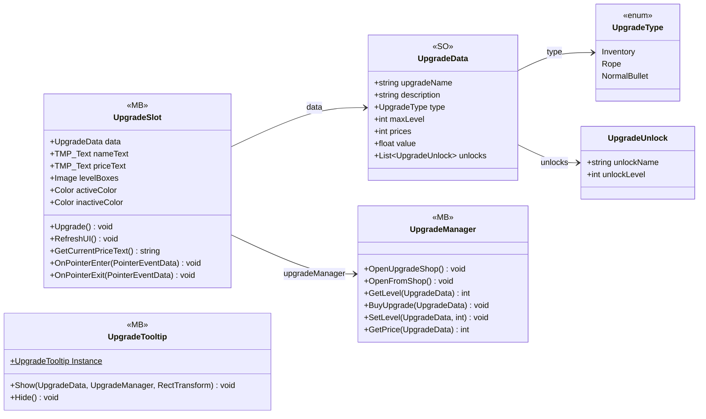

# UI/Upgrades

6 types · 446 LOC (non-blank) · depends on: [Gameplay/QuestSystems/Quest](Gameplay_QuestSystems_Quest.md) ×3, [Gameplay/Projectiles](Gameplay_Projectiles.md) ×2, [UI/Shop](UI_Shop.md) ×1, [Core/Services](Core_Services.md) ×1, [UI](UI.md) ×1

[← index](../README.md)

## Event subscriptions

| Subscriber | Publisher | Event |
|---|---|---|
| UpgradeSlot | QuestManager | OnQuestUpdated |

## Files

| Type | Kind | File | LOC |
|---|---|---|---|
| UpgradeData | SO | `UpgradeData.cs:25` | 18 |
| UpgradeManager | MB | `UpgradeManager.cs:9` | 31 |
| UpgradeSlot | MB | `UpgradeSlot.cs:8` | 105 |
| UpgradeTooltip | MB | `UpgradeTooltip.cs:7` | 279 |
| UpgradeType | enum | `UpgradeData.cs:7` | 6 |
| UpgradeUnlock | class | `UpgradeData.cs:15` | 7 |
