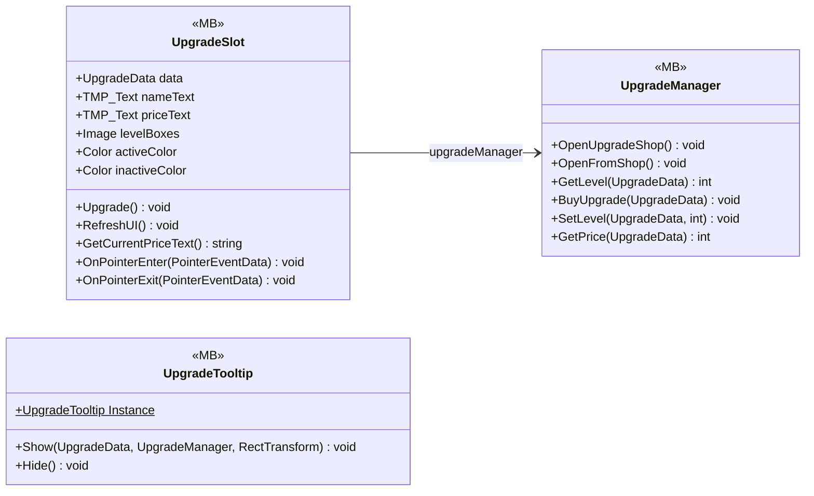

# UI/Upgrades

3 types · 415 LOC (non-blank) · depends on: [Core/Datas/Upgrades](Core_Datas_Upgrades.md) ×6, [Gameplay/QuestSystems/Quest](Gameplay_QuestSystems_Quest.md) ×2, [UI/Shop](UI_Shop.md) ×1, [Core/Services](Core_Services.md) ×1, [UI](UI.md) ×1, [Core/Events](Core_Events.md) ×1, [Gameplay/Projectiles](Gameplay_Projectiles.md) ×1

[← index](../README.md)

## Event subscriptions

| Subscriber | Publisher | Event |
|---|---|---|
| UpgradeSlot | QuestManager | OnQuestUpdated |

## Files

| Type | Kind | File | LOC |
|---|---|---|---|
| UpgradeManager | MB | `UpgradeManager.cs:9` | 31 |
| UpgradeSlot | MB | `UpgradeSlot.cs:8` | 105 |
| UpgradeTooltip | MB | `UpgradeTooltip.cs:7` | 279 |
