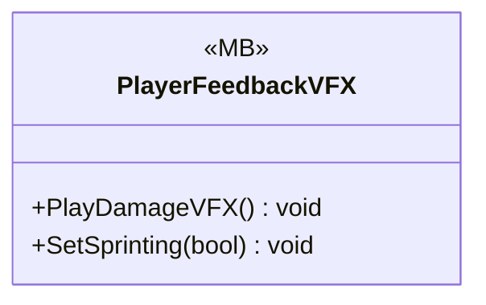

# UI/VFX

1 types · 102 LOC (non-blank) · depends on: [Gameplay/Entities/Players](Gameplay_Entities_Players.md) ×1

[← index](../README.md)

## Event subscriptions

| Subscriber | Publisher | Event |
|---|---|---|
| PlayerFeedbackVFX | Player | OnPlayerDamaged |

## Files

| Type | Kind | File | LOC |
|---|---|---|---|
| PlayerFeedbackVFX | MB | `PlayerFeedbackVFX.cs:9` | 102 |
