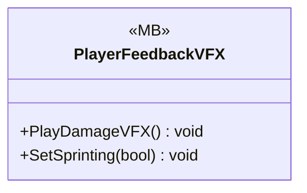

# UI/VFX

1 types · 100 LOC (non-blank) · depends on: none

[← index](../README.md)

## Files

| Type | Kind | File | LOC |
|---|---|---|---|
| PlayerFeedbackVFX | MB | `PlayerFeedbackVFX.cs:7` | 100 |
